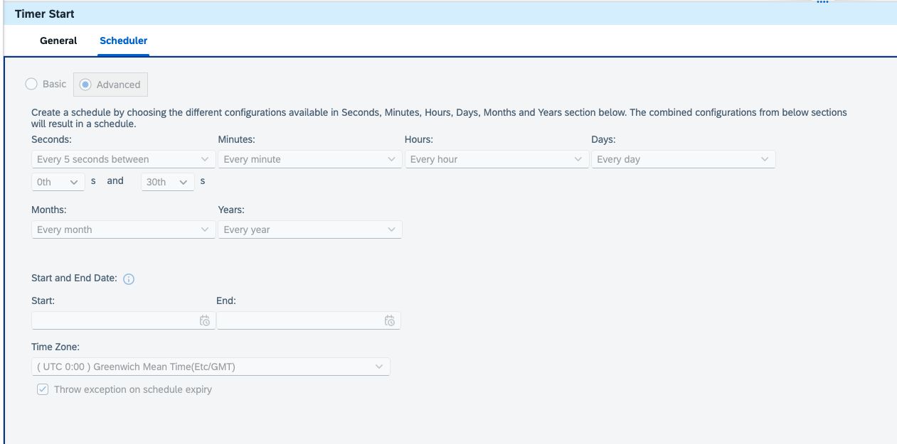

<!-- loio84a57f59ebfe4c629d8901e150d5c9c4 -->

# Configure Advanced Timer Parameters Using the OData API

This topic describes the supported quartz cron expression combinations for the Advanced Timer flow step, along with API examples for each field.

> ### Note:  
> The configurations via OData API are supported for the Timer version 1.4 and above.


## Context

When you configure the timer \(advanced\) using the configuration API, the topic explains the values Parameter Key can have. For details about API, see [Configure integration flow via OData API](https://api.sap.com/api/IntegrationContent/resource/Configurations_of_Integration_Flow)

> ### Remember:  
> When using the OData API to retrieve or update configuration, the response reflects the configurations for All option not those of a specific runtime profile. If you need to view or modify values at the runtime profile level, use the UI instead. See [Configure Externalized Parameters of an Integration Flow](https://help.sap.com/docs/integration-suite/isuite-integrations-and-apis/configure-externalized-parameters-of-integration-flow?version=CLOUD&ai=true)


<a name="loio84a57f59ebfe4c629d8901e150d5c9c4__supported_combinations"/>

## Supported Combinations

The Advanced Timer uses a **Quartz-compatible 7-field cron expression**. Fields are listed from top to bottom: Seconds, Minutes, Hours, Day of Month, Month, Day of Week, and Year.

> ### Note:  
> When you specify a value for Day of Month, set Day of Week to `?`, and vice versa. Only one of these fields can specify a value at a time; the other must be set to `?`.

The table lists the fields configurable via **Scheduler UI and OData APIs** along with exceptions.


<table>
<tr>
<th valign="top">

Field

</th>
<th valign="top">

Supported Features

</th>
<th valign="top">

Example

</th>
<th valign="top">

Remarks

</th>
</tr>
<tr>
<td valign="top" rowspan="5">

*Seconds*

</td>
<td valign="top">

All values \(`*`\)

</td>
<td valign="top">

`*`

</td>
<td valign="top">

Triggers every second

</td>
</tr>
<tr>
<td valign="top">

List \(`,`\)

</td>
<td valign="top">

`0,15,30,45`

</td>
<td valign="top">

Triggers at seconds 0, 15, 30, and 45

</td>
</tr>
<tr>
<td valign="top">

Range \(`-`\)

</td>
<td valign="top">

`10-20`

</td>
<td valign="top">

Triggers every second between second 10 and 20. UI normalizes display to the `/1` step form

</td>
</tr>
<tr>
<td valign="top">

Range with step \(`-/`\)

</td>
<td valign="top">

`0-30/5`

</td>
<td valign="top">

Triggers every 5 seconds between second 0 and 30

</td>
</tr>
<tr>
<td valign="top">

Step from value \(`/`\)

</td>
<td valign="top">

`0/10`

</td>
<td valign="top">

Triggers every 10 seconds starting at second 0.

> ### Note:  
> \*/n is not supported.


</td>
</tr>
<tr>
<td valign="top" rowspan="5">

*Minutes*

</td>
<td valign="top">

All values \(`*`\)

</td>
<td valign="top">

`*`

</td>
<td valign="top">

Triggers every minute

</td>
</tr>
<tr>
<td valign="top">

List \(`,`\)

</td>
<td valign="top">

`0,15,30,45`

</td>
<td valign="top">

Triggers at minutes 0, 15, 30, and 45

</td>
</tr>
<tr>
<td valign="top">

Range \(`-`\)

</td>
<td valign="top">

`10-20`

</td>
<td valign="top">

Triggers every minute between minute 10 and 20

</td>
</tr>
<tr>
<td valign="top">

Range with step \(`-/`\)

</td>
<td valign="top">

`0-30/5`

</td>
<td valign="top">

Triggers every 5 minutes between minute 0 and 30

</td>
</tr>
<tr>
<td valign="top">

Step from value \(`/`\)

</td>
<td valign="top">

`0/5`

</td>
<td valign="top">

Triggers every 5 minutes starting at minute 0.

> ### Note:  
> \*/n is not supported.


</td>
</tr>
<tr>
<td valign="top" rowspan="5">

*Hours*

</td>
<td valign="top">

All values \(`*`\)

</td>
<td valign="top">

`*`

</td>
<td valign="top">

Triggers every hour

</td>
</tr>
<tr>
<td valign="top">

List \(`,`\)

</td>
<td valign="top">

`9,15`

</td>
<td valign="top">

Triggers at 9:00 and 15:00

</td>
</tr>
<tr>
<td valign="top">

Range \(`-`\)

</td>
<td valign="top">

`8-18`

</td>
<td valign="top">

Triggers every hour between 8:00 and 18:00

</td>
</tr>
<tr>
<td valign="top">

Range with step \(`-/`\)

</td>
<td valign="top">

`8-18/2`

</td>
<td valign="top">

Triggers every 2 hours between 8:00 and 18:00

</td>
</tr>
<tr>
<td valign="top">

Step from value \(`/`\)

</td>
<td valign="top">

`0/6`

</td>
<td valign="top">

Triggers every 6 hours starting at midnight.

> ### Note:  
> \*/n is not supported.


</td>
</tr>
<tr>
<td valign="top" rowspan="7">

*Day of Month*

</td>
<td valign="top">

No specific value \(`?`\)

</td>
<td valign="top">

`?`

</td>
<td valign="top">

Defers to the day-of-week field. Required when a day-of-week value is set

</td>
</tr>
<tr>
<td valign="top">

Single day

</td>
<td valign="top">

`15`

</td>
<td valign="top">

Triggers on the 15th of every month

</td>
</tr>
<tr>
<td valign="top">

Step from day \(`/`\)

</td>
<td valign="top">

`1/5`

</td>
<td valign="top">

Triggers every 5 days starting on the 1st. **UI only** — not supported via API \(returns 500\)

</td>
</tr>
<tr>
<td valign="top">

Last day of month \(`L`\)

</td>
<td valign="top">

`L`

</td>
<td valign="top">

Triggers on the last day of the month. **UI only** — not supported via API \(returns 500\)

</td>
</tr>
<tr>
<td valign="top">

Last weekday of month \(`LW`\)

</td>
<td valign="top">

`LW`

</td>
<td valign="top">

Triggers on the last weekday of the month. **UI only** — not supported via API \(returns 500\)

</td>
</tr>
<tr>
<td valign="top">

First weekday of month \(`1W`\)

</td>
<td valign="top">

`1W`

</td>
<td valign="top">

Triggers on the first weekday of the month. **UI only** — not supported via API \(returns 500\)

</td>
</tr>
<tr>
<td valign="top">

Offset from last day \(`L-n`\)

</td>
<td valign="top">

`L-5`

</td>
<td valign="top">

Triggers 5 days before the end of the month. **UI only** — not supported via API \(returns 500\)

</td>
</tr>
<tr>
<td valign="top" rowspan="5">

*Month*

</td>
<td valign="top">

All values \(`*`\)

</td>
<td valign="top">

`*`

</td>
<td valign="top">

Triggers every month

</td>
</tr>
<tr>
<td valign="top">

Named single value

</td>
<td valign="top">

`JAN`

</td>
<td valign="top">

Triggers only in January. Use named tokens \(`JAN`–`DEC`\) — bare numeric \(Example `1`\) returns 400

</td>
</tr>
<tr>
<td valign="top">

Named list

</td>
<td valign="top">

`JAN,JUL`

</td>
<td valign="top">

Triggers in January and July. Use named tokens only

</td>
</tr>
<tr>
<td valign="top">

Numeric range \(`-`\)

</td>
<td valign="top">

`3-9`

</td>
<td valign="top">

Triggers every month from March to September. Use numeric form — named range \(Example `MAR-SEP`\) is not supported

</td>
</tr>
<tr>
<td valign="top">

Numeric step \(`/`\)

</td>
<td valign="top">

`3/3`

</td>
<td valign="top">

Triggers every 3 months starting in March. Use numeric form — named step \(Example `MAR/3`\) is not supported

</td>
</tr>
<tr>
<td valign="top" rowspan="6">

*Day of Week*

</td>
<td valign="top">

No specific value \(`?`\)

</td>
<td valign="top">

`?`

</td>
<td valign="top">

Defers to the day-of-month field. Required when a day-of-month value is set

</td>
</tr>
<tr>
<td valign="top">

Named single value

</td>
<td valign="top">

`MON`

</td>
<td valign="top">

Triggers every Monday. Use named tokens \(`SUN`–`SAT`\), not numeric

</td>
</tr>
<tr>
<td valign="top">

Named list

</td>
<td valign="top">

`MON,WED,FRI`

</td>
<td valign="top">

Triggers every Monday, Wednesday, and Friday. Use named tokens only

</td>
</tr>
<tr>
<td valign="top">

Numeric step \(`/`\)

</td>
<td valign="top">

`1/2`

</td>
<td valign="top">

Triggers every 2 days starting on Sunday

</td>
</tr>
<tr>
<td valign="top">

Last weekday of month \(`dL`\)

</td>
<td valign="top">

`6L`

</td>
<td valign="top">

Triggers on the last Friday of the month. `6` = Friday \(SUN=1 … SAT=7\)

</td>
</tr>
<tr>
<td valign="top">

Nth weekday of month \(`d#N`\)

</td>
<td valign="top">

`2#2`

</td>
<td valign="top">

Triggers on the 2nd Monday of the month

</td>
</tr>
<tr>
<td valign="top" rowspan="4">

*Year*

</td>
<td valign="top">

All values \(`*`\)

</td>
<td valign="top">

`*`

</td>
<td valign="top">

Triggers every year

</td>
</tr>
<tr>
<td valign="top">

List \(`,`\)

</td>
<td valign="top">

`2026,2028`

</td>
<td valign="top">

Triggers in 2026 and 2028 only

</td>
</tr>
<tr>
<td valign="top">

Range \(`-`\)

</td>
<td valign="top">

`2026-2030`

</td>
<td valign="top">

Triggers every year from 2026 to 2030

</td>
</tr>
<tr>
<td valign="top">

Step \(`/`\)

</td>
<td valign="top">

`2026/2`

</td>
<td valign="top">

Triggers every 2 years starting in 2026

</td>
</tr>
<tr>
<td valign="top">

*Time Zone*

</td>
<td valign="top">

`--tz=<zone>`

</td>
<td valign="top">

`--tz=Etc/GMT`

</td>
<td valign="top">

Sets the timezone for the schedule. Optional; when omitted the API silently substitutes a server default timezone - always specify explicitly

> ### Note:  
> The `<zone>` placeholder specifies the time zone to use for the schedule. Provide a valid time zone ID, such as `Asia/Kolkata` for India Standard Time or `Etc/GMT` for Greenwich Mean Time.


</td>
</tr>
<tr>
<td valign="top">

*Start*

</td>
<td valign="top">

`--startAt=<datetime>`

</td>
<td valign="top">

`--startAt=2026-09-08T11:46:06`

</td>
<td valign="top">

Earliest datetime the trigger may fire. Optional; independent of `--endAt`

-   The format for date is

    `YYYY-MM-DD`

-   The format for time is

    `Hour:Minute:Seconds`

    Example: `09:18:50`


</td>
</tr>
<tr>
<td valign="top">

*End*

</td>
<td valign="top">

`--endAt=<datetime>`

</td>
<td valign="top">

`--endAt=2026-09-09T11:46:09`

</td>
<td valign="top">

Latest datetime the trigger may fire. Optional; must be later than `--startAt`, otherwise API returns 400

For example:

```
simple.repeat=DAYS --simple.every=1 --tz=IST --startAt=2026-09-10T08:00:00 --endAt=2026-12-31T08:00:00
```


</td>
</tr>
</table>


<a name="loio84a57f59ebfe4c629d8901e150d5c9c4__put_operation"/>

## Updating a Cron Trigger via OData API

Use the following PUT request to update the cron schedule of an externalized Advanced Timer parameter.

*Endpoint*

```
PUT https://<host>/api/v1/IntegrationDesigntimeArtifacts(Id='<ArtifactId>',Version='active')/$links/Configurations('<ParameterKey>')
```

*Request Headers*


<table>
<tr>
<th valign="top">

Header

</th>
<th valign="top">

Value

</th>
</tr>
<tr>
<td valign="top">

`x-csrf-token`

</td>
<td valign="top">

Fetch token from a prior GET request and pass it here

</td>
</tr>
<tr>
<td valign="top">

`Content-Type`

</td>
<td valign="top">

`application/json`

</td>
</tr>
</table>

*Request Body*

```
{
    "ParameterValue": "0-30/5 * * ? * * * --tz=Etc/GMT",
    "DataType": "custom:schedule"
  }
```

The configuration in Request Body via OData API shall look like below the configuration in the UI.

*Response*

A successful update returns HTTP `202 Accepted`. No response body is returned. Use a subsequent GET request to verify the updated value.


<a name="loio84a57f59ebfe4c629d8901e150d5c9c4__example_configurations"/>

## Example Configurations

The following table provides one representative API configuration per field. All examples use `"DataType": "custom:schedule"`.


<table>
<tr>
<th valign="top">

Field

</th>
<th valign="top">

Parameter Value

</th>
<th valign="top">

Description

</th>
</tr>
<tr>
<td valign="top">

*Seconds*

</td>
<td valign="top">

`0-30/5 * * ? * * * --tz=Etc/GMT`

</td>
<td valign="top">

Triggers every 5 seconds between second 0 and 30, every minute, every hour

</td>
</tr>
<tr>
<td valign="top">

*Minutes*

</td>
<td valign="top">

`0 0/5 * ? * * * --tz=Etc/GMT`

</td>
<td valign="top">

Triggers every 5 minutes starting at minute 0, at second 0 of each trigger

</td>
</tr>
<tr>
<td valign="top">

*Hours*

</td>
<td valign="top">

`0 0 8-18/2 ? * * * --tz=Etc/GMT`

</td>
<td valign="top">

Triggers every 2 hours between 8:00 and 18:00, at minute 0 and second 0

</td>
</tr>
<tr>
<td valign="top">

*Day of Month*

</td>
<td valign="top">

`0 30 8 15 * ? * --tz=Etc/GMT`

</td>
<td valign="top">

Triggers on the 15th of every month at 08:30. `?` in day-of-week defers to the day-of-month value

</td>
</tr>
<tr>
<td valign="top">

*Month*

</td>
<td valign="top">

`0 0 9 1 3-9 ? * --tz=Etc/GMT`

</td>
<td valign="top">

Triggers on the 1st of every month from March to September at 9:00

</td>
</tr>
<tr>
<td valign="top">

*Day of Week*

</td>
<td valign="top">

`0 0 9 ? * MON,WED,FRI * --tz=Etc/GMT`

</td>
<td valign="top">

Triggers every Monday, Wednesday, and Friday at 9:00. `?` in day-of-month defers to the day-of-week value

</td>
</tr>
<tr>
<td valign="top">

*Year*

</td>
<td valign="top">

`0 0 9 1 JAN ? 2026-2030 --tz=Etc/GMT`

</td>
<td valign="top">

Triggers on 1st January at 9:00, every year from 2026 to 2030

</td>
</tr>
<tr>
<td valign="top">

*Time Zone*

</td>
<td valign="top">

`0 0/5 * ? * * * --tz=Asia/Kolkata`

</td>
<td valign="top">

Triggers every 5 minutes using India Standard Time \(UTC+5:30\)

</td>
</tr>
<tr>
<td valign="top">

*Start and End*

</td>
<td valign="top">

`0 0/5 * ? * * * --tz=Etc/GMT --startAt=2026-09-08T11:46:06 --endAt=2026-09-09T11:46:09`

</td>
<td valign="top">

Triggers every 5 minutes within the specified start and end window; omitting either flag clears it

</td>
</tr>
</table>

**Related Information**  


[Update and Validate Configuration Parameters](update-and-validate-configuration-parameters-2b92d3d.md "")

