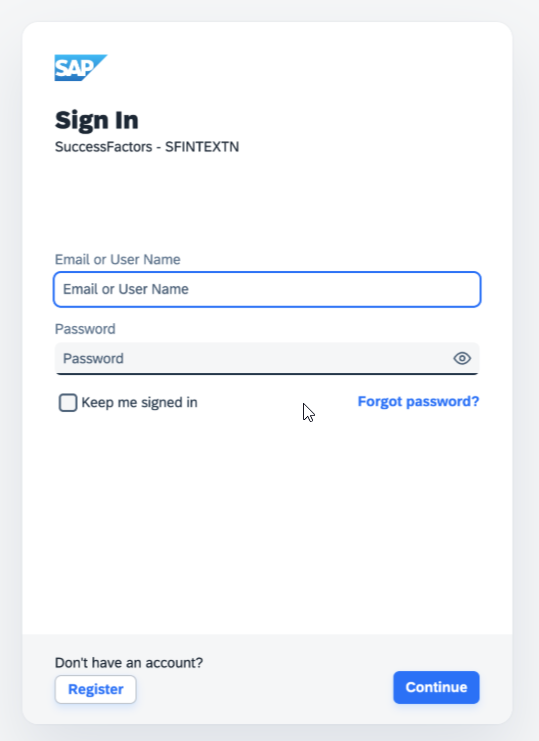
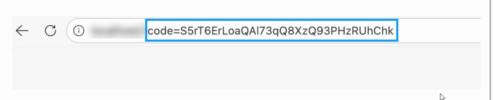

<!-- loio876cea2f90ad4dd49a05c8efa496fd9c -->

# Connect to an SAP SuccessFactors Business System for API Discovery

To enable API discovery from SAP SuccessFactors, create the required destination in the SAP BTP cockpit using the SAP SuccessFactors Extensibility Service.


## Procedure

1.  Make the SAP SuccessFactors extensibility service accessible in the subaccounts in which you want to discover and consume the APIs .

    To do so, configure the entitlements and assign the corresponding quota where the extension applications will reside. For detailed instruction, see [Configure the Entitlements for the SAP SuccessFactors Extensibility Service](https://help.sap.com/docs/btp/sap-business-technology-platform/configure-entitlements-for-sap-successfactors-extensibility-service?locale=en-US&state=PRODUCTION&version=Cloud).

2.  Configure the destination.

    To do so, create a service instance of the SAP SuccessFactors Extensibility service using the api-access service plan. For more information, see [Create a Service Instance to Consume the SAP SuccessFactors HXM Suite OData API](https://help.sap.com/docs/btp/sap-business-technology-platform/create-service-instance-to-consume-sap-successfactors-hxm-suite-odata-api?locale=en-US&state=PRODUCTION&version=Cloud).

    During service instance creation, an HTTP destination is automatically generated at the subaccount level. This destination contains the required authentication configuration to access the APIs of the associated system.

3.  SAP SuccessFactors supports the `OAuth 2.0 SAML bearer assertion` flow as the authentication mechanism. To enable this scenario, a trust relationship must be established between the SAP Business Technology Platform account and the corresponding SuccessFactors system.

    To configure SAP SuccessFactors as a trusted identity provider in SAP BTP, see [here](https://help.sap.com/docs/btp/sap-business-technology-platform/configure-sf-as-trusted-idp-in-btp-man).

    To configure the subaccount as a trusted service provider in SAP SuccessFactors, see [here](https://help.sap.com/docs/btp/sap-business-technology-platform/configure-subaccount-as-trusted-service-provider-in-sap-successfactors).

4.  Create the Process Integration Runtime \(PIR\) credentials abd configure the grant types `"client_credentials"` and `"authorization_code"`. For more information, see [Invoke an API Artifact by Obtaining Credentials through Process Integration Runtime](invoke-an-api-artifact-by-obtaining-credentials-through-process-integration-runtime-b63baa2.md).

    > ### Sample Code:  
    > ```
    > {
    >     "grant-types": [
    >         "client_credentials",
    >         "authorization_code"
    >     ],
    >     "redirect-uris": [
    >         "http://localhost"
    >     ],
    >     "roles": [
    >         "ESBMessaging.send"
    >     ],
    >     "token-validity": 3600
    > }
    > ```

5.  To obtain the authorization code, copy the following URL in the browser and press enter: `https://<authentication endpoint from Process Integration runtime>/oauth/authorize ?response_type=code &client_id=<url encoded ClientID from Process Integration Runtime>&redirect_uri=http://localhost`

    1.  Select the SAP SuccessFactors identity provider displayed on the screen.

        

    2.  In the login screen, provide the credentials of the SAP SuccessFactors system and select *Continue*.

        

    3.  On successful login, a code will be generated as part of the URL. For example, `http://localhost/?code=rhQln63y1YhZqAYiXejm1pTzk-XJ8JN`

        


6.  Use a REST API client to call the following the API to get the authentication bearer token to invoke the SuccessFactors based API artifact:

    ****


    <table>
    <tr>
    <th valign="top">

    Attribute
    
    </th>
    <th valign="top">

    Value
    
    </th>
    </tr>
    <tr>
    <td valign="top">
    
    Method
    
    </td>
    <td valign="top">
    
    POST
    
    </td>
    </tr>
    <tr>
    <td valign="top">
    
    URL
    
    </td>
    <td valign="top">
    
    This is the token URL from Process Integration Runtime credentials
    
    </td>
    </tr>
    <tr>
    <td valign="top">
    
    header
    
    </td>
    <td valign="top">
    
    Content-Type: application/x-www-form-urlencoded
    
    </td>
    </tr>
    <tr>
    <td valign="top">
    
    Authorisation
    
    </td>
    <td valign="top">
    
    Basic: ClientID, ClientSecret from Process Integration Runtime
    
    </td>
    </tr>
    <tr>
    <td valign="top">
    
    Request Body
    
    </td>
    <td valign="top">
    
    > ### Sample Code:  
    > ```
    > x-www-form-urlencoded
    > ```


    
    </td>
    </tr>
    <tr>
    <td valign="top">
    
    Request Body Parameter
    
    </td>
    <td valign="top">
    
    `grant_type=authorization_code`

    `redirect_uri=http://localhost`

    `code=code=rhQln63y1YhZqAYiXejm1pTzk-XJ8JN` Copy this code from step 5
    
    </td>
    </tr>
    </table>
    

