<!-- loio3b90a0c1b651494eb2f6dda7f03eb20e -->

<link rel="stylesheet" type="text/css" href="css/sap-icons.css"/>

# Refine and Streamline MCP Server Tool Definitions

Refine the tool definitions in your MCP Server by adding or deleting tools, hiding parameters, simplifying enum values, and updating tool names and descriptions.

For each tool in your MCP Server, you can refine the input schema, output schema, and tool metadata independently. This gives you granular control over the agent-facing schema at the tool level, so you can apply different levels of simplification to different tools within the same MCP Server based on how each tool is used. After you save your changes, deploy the MCP Server to make the updated tool definitions available at runtime.

## Prerequisites

You have an existing MCP server that needs to be updated. For more information, see the following topics:

-   [Create an MCP Server from an API Artifact](create-an-mcp-server-from-an-api-artifact-9f18140.md)
-   [Create an MCP Server from an HTTP Endpoint](create-an-mcp-server-from-an-http-endpoint-b59f141.md)
-   [Create an MCP Server by Referring to an RFC-Based Backend](create-an-mcp-server-by-referring-to-an-rfc-based-backend-cbb8b78.md)
-   [Create an MCP Server Using Remote MCP Server as the Source](create-an-mcp-server-using-remote-mcp-server-as-the-source-742216d.md)

## Procedure

1.  Go to *Design* \> *Integrations and APIs* and search for the MCP server package you want to update.
2.  Go to the *Artifacts* tab and select the MCP server artifact you want to update. Choose *Edit*.

    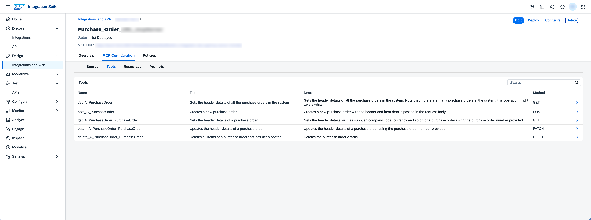

## Tools

You can add or delete specific resources as MCP tools. These tools allow AI agents to interact with your artifacts in a structured and controlled way.

For each tool, you can also:

-   Modify the **Name**, **Title**, and **Description** in the *Details* tab.

-   View the corresponding HTTP method and resource path or RFC.

> ### Note:  
> Each MCP server supports up to 50 tools.

1.  Go to *MCP Configuration* \> *Tools* tab and choose *Add*.

    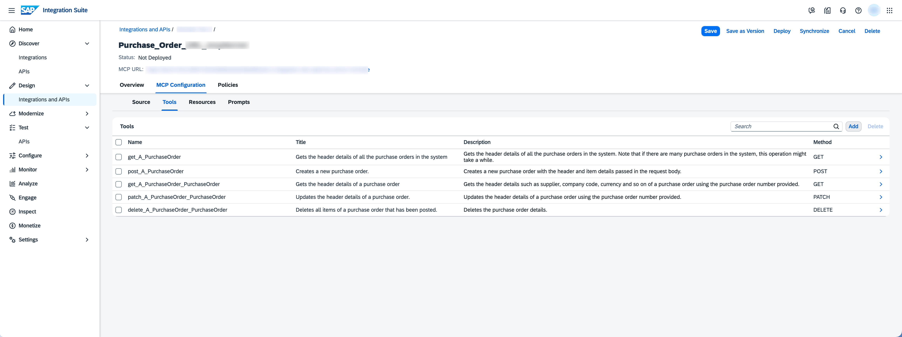

2.  Select the tools that you want to expose, and choose *Add*.

    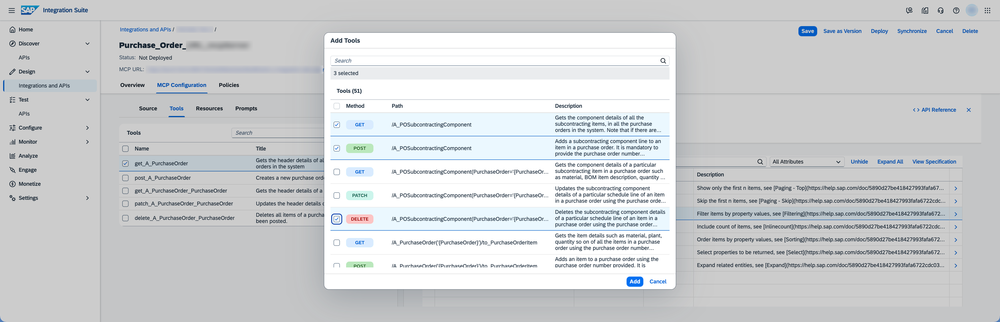

    You can also *Delete* tools from the list.

    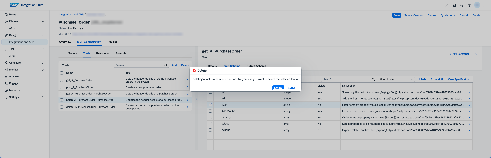

## Input and Output Schemas

You can hide or unhide *Tool Attributes* in the input and output schemas, which are derived from the type of artifact you selected. The input schema defines the parameters that an AI agent can provide when it invokes the tool, while the output schema defines the structure of the response returned by the tool.

> ### Note:  
> Modifying the following *Composite* data types is not supported:
> 
> -   *allOf*
> -   *oneOf*
> -   *anyOf*
> -   *not*

> ### Note:  
> If you have hidden attributes in a tool's input or output schema, synchronization retains those settings unless they conflict with updates from the source API artifact.
> 
> For example, if an attribute you marked as hidden becomes mandatory in the input or output schema after synchronization, the hidden setting is removed, and the attribute is displayed.

1.  Go to *Input Schema* or *Output Schema* tab.

    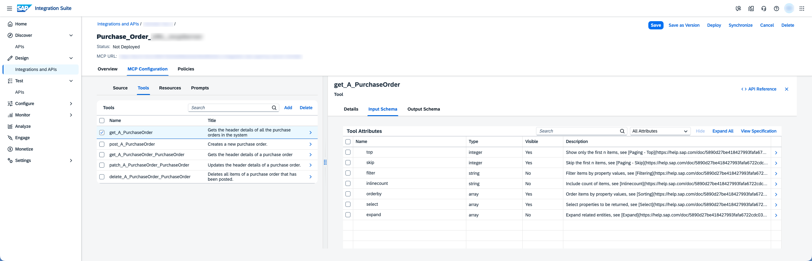

2.  Select the tool attribute that you want to refine. You can do the following:
    1.  View all attributes, which include hidden ones, or only visible attributes.

        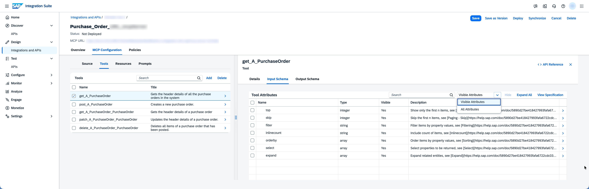

    2.  Hide and unhide tool attributes.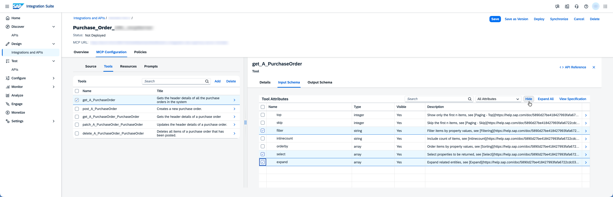

        Once you hide attributes, they are listed as not visible in the *Tool Attributes* list, and you can choose to *Unhide* them.

        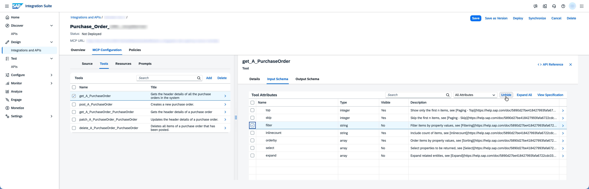

3.  Select a tool attribute to refine.

    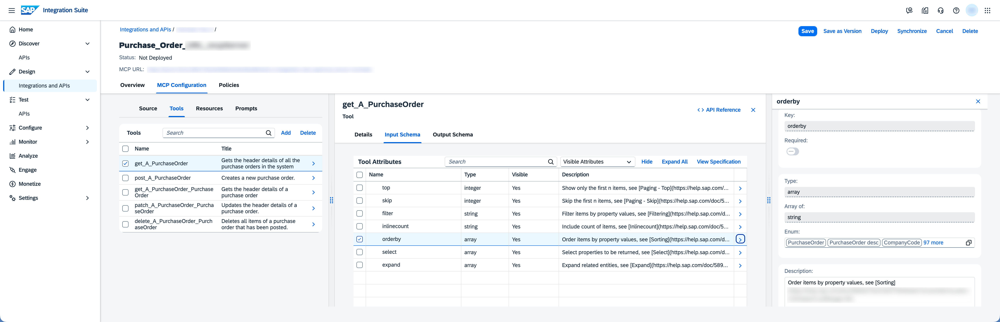

4.  Choose  value help button to open the list of enums. Select or deselect the enums you want to make visible or hide. Choose *Confirm*.

    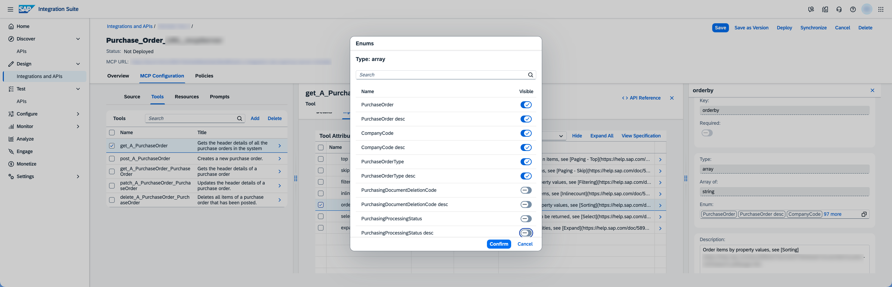

5.  You can also modify the selected tool attribute description.

    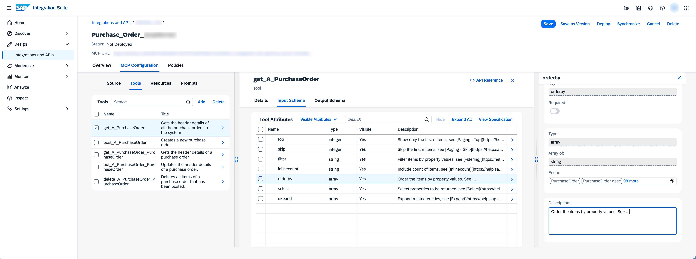

## Final Steps and Results

1.  Choose *Save* to save your changes.
2.  Choose *Deploy* to the runtime to make your MCP server available for invocation. See [Deploy an MCP Server](deploy-an-mcp-server-017ba42.md).

